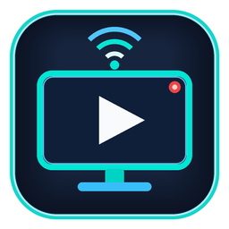
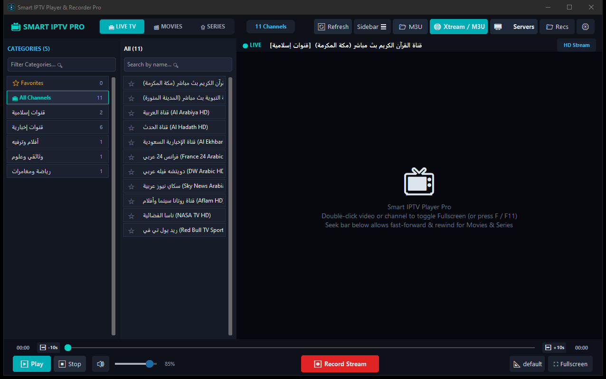

<div align="center">



# Smart IPTV Player & Recorder Pro

**The First Desktop IPTV Player with Built-In One-Click Screen/Stream Recording**  
**أول مشغل IPTV لسطح المكتب يدعم التسجيل الفوري المباشر من الشاشة بضغطة زر**

[](#)
[](#)
[](#)
[](LICENSE)

</div>

---

## 📸 Preview

<div align="center">
  
</div>

---

## 🔴 Built-In Instant Screen / Stream Recording (Core Highlight)

Unlike traditional IPTV players that only let you watch, **Smart IPTV Player & Recorder Pro** is designed from the ground up as **the first desktop IPTV player with built-in one-click recording**:

- **Record Anywhere (`Windowed` or `Fullscreen`):** Click **`⏺ Record Stream`** on the main bar, click **`⏺ Record`** directly inside the auto-hiding Fullscreen Floating OSD, or press **`R`** at any moment while watching.
- **Zero-Lag Direct Capture (`FFmpeg -c copy`):** Captures video frames losslessly at original stream quality with near-zero CPU usage and normalized AAC audio for universal playback.
- **Crash-Proof Fragmented MP4 + Faststart Remux:** Streams record safely to a temporary `.part` container and finalize cleanly into seekable `.mp4` (or raw `.ts`) on a background thread without freezing the UI.
- **Live Recording Telemetry:** Real-time elapsed timer (`⏱️ 00:03:45`) and live file size counter (`💾 48.2 MB`), visible in both windowed mode and Fullscreen OSD.
- **Automatic End Detection:** Detects stream drops cleanly and falls back to native HTTP capture with custom `User-Agent` / `Referer` headers if needed.

---

## ✨ Key Features

- **Tri-Mode Catalog (`LIVE TV` | `MOVIES` | `SERIES`):** Seamless switching between live channels, VOD movies, and multi-season TV series with episode browsing.
- **✦ Recently Added (Latest 30):** Dedicated **`✦ Recently Added`** smart category in Movies and Series sorted by newest server timestamps.
- **Exact Server Ordering:** Preserves the IPTV provider's exact category order (`get_*_categories`) and channel numbering (`num`).
- **Multi-Server Manager (`🖥️ Servers`) & Dual Login (`🌐 Xtream / M3U`):**
  - Add servers via **Xtream Codes** (`IPTV Name`, `Server URL`, `Username`, `Password`) or **M3U / Direct URL**.
  - Switch between multiple saved servers in one click, see the active server indicator (`● ACTIVE`), or delete old servers.
- **Blazing-Fast Widget-Pooled UI:** Row widget pooling (`_cat_pool`, `_chan_pool`), background disk caching, and automatic background prefetching keep mode & category switching responsive even with 20,000+ items.
- **True Fullscreen + Floating OSD:** Double-click video or channel (or press `F` / `F11`) to fill 100% of the screen. Hover near the bottom edge to reveal the floating control bar (Seek, Play/Pause, Stop, Volume, Record, Aspect Ratio, Exit) — disappears immediately when you move the mouse away.
- **Mouse Wheel Volume Control:** Scroll the mouse wheel over the video area or control bar (windowed or fullscreen) to adjust volume `±5%` without affecting the timeline slider.
- **Unified Arabic & English Typography:** Clean `Segoe UI` rendering across all menus, search bars, dialogs, and RTL/LTR channel names.
- **Setup Installer & True Portable Mode:** Available both as a standard Windows installer (`SmartIPTVPlayer_Setup.exe`) and a standalone Portable edition (`portable.txt` stores all `userdata/` and `recordings/` next to the `.exe`).

---

## 🚀 Installation & Running

### Option 1: Windows Installer (`Setup`)
Download and run `SmartIPTVPlayer_Setup.exe` from Releases to install cleanly with Desktop & Start Menu shortcuts, bundled LibVLC & FFmpeg, and Windows uninstaller support.

### Option 2: Portable Edition
Extract `SmartIPTVPlayer_Portable.zip` anywhere (PC or USB drive) and run `SmartIPTVPlayer.exe`. Keeping `portable.txt` keeps all settings, favorites, server list, cache, and recordings self-contained inside the folder.

### Option 3: Run from Source (Python 3.10+)
```bash
git clone https://github.com/spikyman9/smart-iptv-player.git
cd smart-iptv-player
pip install -r requirements.txt
python main.py
```
*(Ensure [VLC](https://www.videolan.org/) is installed on Windows or place `libvlc.dll`, `libvlccore.dll`, and `plugins/` inside `./vlc/`, and optionally place `ffmpeg.exe` on `PATH` or next to the script.)*

---

## ⌨️ Keyboard & Mouse Controls

| Input | Action |
| :--- | :--- |
| **Mouse Wheel** *(over video / controls)* | Volume Up / Down (`±5%`) |
| **Double-Click** *(video or channel)* / **F** / **F11** | Toggle Fullscreen |
| **Esc** | Exit Fullscreen |
| **Space** | Play / Pause |
| **R** | Start / Stop Recording |
| **A** | Cycle Aspect Ratio (`Fill`, `16:9`, `4:3`, `default`) |
| **M** | Mute / Unmute |
| **Up / Down Arrows** | Volume `+5%` / `-5%` |
| **Left / Right Arrows** | Seek `-10s` / `+10s` *(VOD & Series)* |

---

## 🇪🇬 نبذة بالعربية

**Smart IPTV Player & Recorder Pro** هو **أول مشغل IPTV لسطح المكتب يأتي بتسجيل مدمج مباشر من الشاشة/البث بضغطة زر** سواء من الشاشة العادية أو من القائمة العائمة داخل وضع ملء الشاشة (`Fullscreen`).

- **تسجيل احترافي بدون تقطيع:** تسجيل مباشر بصيغة `MP4` أو `TS` مع عدّاد للوقت والحجم وإمكانية التشغيل عبر اختصار `R`.
- **إدارة السيرفرات (`Servers`):** إضافة والتنقل بين أكثر من سيرفر عبر بيانات **Xtream Codes** أو روابط **M3U**.
- **أقسام مرتبة وسرعة فائقة:** عرض البث المباشر والأفلام والمسلسلات بنفس ترتيب السيرفر، مع قسم **`✦ Recently Added`** لأحدث 30 فيلم ومسلسل، وواجهة موحدة بخط `Segoe UI` للغة العربية.
- **نسخة تثبيت (`Setup`) ونسخة محمولة (`Portable`)** جاهزتان للتشغيل مباشرة مع مكتبات VLC وFFmpeg.

---

<div align="center">
Made with ❤️ using Python, CustomTkinter, LibVLC, and FFmpeg • Licensed under <a href="LICENSE">MIT</a>
</div>
